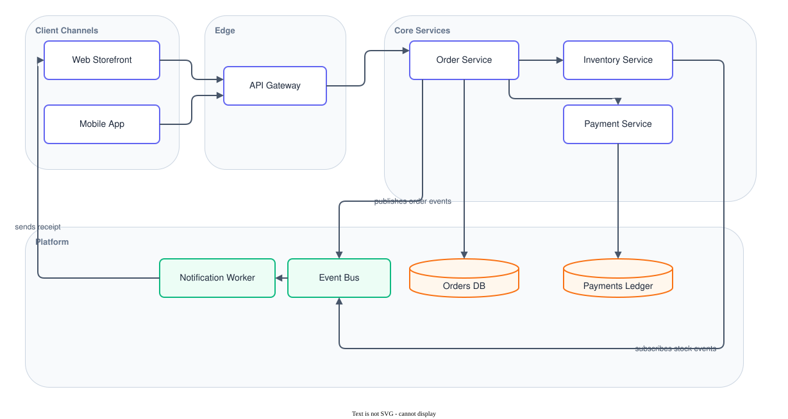

# Draw.io architecture diagram skill

An agent skill that produces professional architecture diagrams as draw.io XML and ships them as a committed `.drawio.svg` that renders inline in Markdown and still opens editable in draw.io.

## The problem it solves

Diagrams written by an agent are usually technically valid and visually wrong: a label sits on top of a shape, an edge threads a cluster, one diagram is blue and the next is green. A validator cannot see any of that. The skill therefore owns three things a validator cannot: the layout, a pinned house style, and the loop that looks at the render and corrects it.

## What it produces

Two files, always both of them.

| File | Who reads it | What it is |
|---|---|---|
| `<name>.drawio` | the maintainer | the source, plain XML, diffable in git |
| `<name>.drawio.svg` | the reader | the committed artifact, renders inline in Markdown, reopens in draw.io with the diagram intact |

The `.drawio.svg` carries the diagram XML inside its root `content` attribute. That is what makes it both a picture and an editable file. A PNG cannot be fixed by the reader who spots the problem.

The worked example this repository ships, the order-intake reference architecture:



Its source is [`examples/order-intake.drawio`](examples/order-intake.drawio), and the artifact above is the file GitHub is rendering right now. Download it, open it in draw.io, and the diagram is there to edit.

## The loop in one line

`pick the mode -> apply the house style -> author the XML -> validate -> render -> look at the render -> correct -> commit both files`

The step that matters is the sixth. A render that parses is not a render that reads.

## Install

The skill is a plain Agent Skills bundle. Copy the directory into any of the locations an agent harness reads:

```bash
# Per project, from a clone of this repository
mkdir -p .opencode/skills && cp -r skills/drawio-architecture-diagram .opencode/skills/

# Or for this machine, user-wide
mkdir -p ~/.config/opencode/skills && cp -r skills/drawio-architecture-diagram ~/.config/opencode/skills/
```

The bundle carries everything the skill needs to draw a diagram: its render script, its validator, and the reference documents the skill points at. The fixture corpus the validator's self-test runs over is the repository's development evidence and does not travel with the bundle, so a vendored copy runs the validator against its own diagrams rather than against the self-test.

## Use it

Ask for an architecture diagram, a service map, or a picture of infrastructure held in CloudFormation, CDK or Terraform. The skill picks the mode, applies the house style, authors the XML, renders the artifact, looks at the render, and hands back a committed file pair.

For a small diagram that belongs inside a paragraph, use Mermaid instead. It renders natively in Markdown and keeps no artifact in sync.

## The parts

| Path | What it holds |
|---|---|
| `skills/drawio-architecture-diagram/SKILL.md` | the skill definition, the primary artifact |
| `skills/drawio-architecture-diagram/references/house-style.md` | the pinned palette, type scale, spacing and edge rules |
| `skills/drawio-architecture-diagram/references/xml-rules.md` | the file format, the cell model, the style strings |
| `skills/drawio-architecture-diagram/scripts/render-drawio-svg.sh` | renders a source into the committed artifact |
| `skills/drawio-architecture-diagram/scripts/validate-drawio-svg.py` | compares a committed artifact against its source, and self-tests the comparison |
| `examples/` | the worked example the skill ships with |
| `tests/fixtures/` | the diagrams the exporter's behaviour was measured on |

## Test command

```bash
bash scripts/test.sh
```

Runs the validator's own self-test over the fixture diagrams and over deliberately damaged copies, checks the committed example artifact against its source, and renders every Mermaid diagram this repository ships.

## Licence

MIT. See [`LICENSE`](LICENSE).
