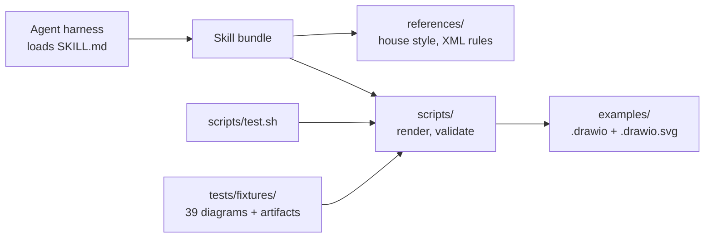

# Technical Architecture

Two components and one artifact of value:

1. **The skill bundle** (`skills/drawio-architecture-diagram/`) — the prose protocol an agent consumes, the two reference documents it points at, and the two scripts it runs. No runtime of its own.
2. **The test gate** (`scripts/test.sh`) — the validator's self-test over the fixtures and the damaged copies of them, then the committed example artifact against its source.

The artifact of value is a committed `.drawio.svg`: it renders inline in Markdown and carries the diagram XML, so the reader can download the file the repository ships and keep editing it.

Tech stack: Python 3 standard library for the validator, POSIX bash and Docker for the render, the draw.io desktop CLI inside a pinned container for the export. Detail in [`technical-architecture/tech-stack.md`](technical-architecture/tech-stack.md).
