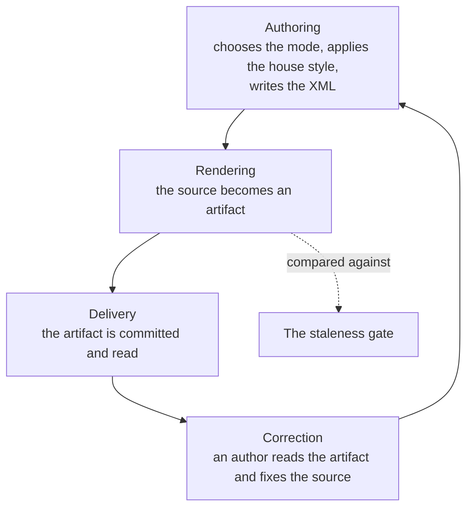

# Context map

Authoring, rendering and delivery are one upstream-downstream chain with a feedback loop: a reader who spots a problem hands it back to the author, who fixes the source and re-renders. The gate sits beside the chain and refuses a delivery whose artifact does not match its source.

The vocabulary is in [`../DOMAIN-MODEL-L1.md`](../DOMAIN-MODEL-L1.md).
